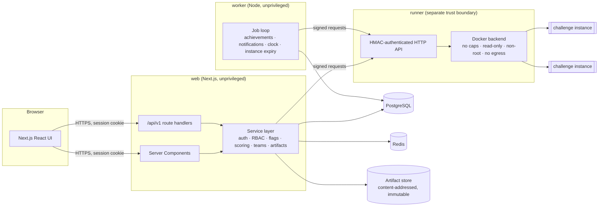

# CyberQuest CTF — Architecture

## 1. Overview

CyberQuest is a multi-tenant Capture-the-Flag platform. It is split into four
deployable processes with deliberately different privilege levels:

* **web** — Next.js App Router. Pages are server components that call the
  service layer directly; interactive forms call the versioned REST API
  (`/api/v1`). Both paths go through the same authorization functions.
* **worker** — polls a Postgres `Job` table using `FOR UPDATE SKIP LOCKED`.
  Handles achievement evaluation, first-blood notifications, competition
  clock transitions (SCHEDULED→ACTIVE→COMPLETED) and instance expiry.
* **runner** — the *only* component allowed to talk to a container engine.
  The web app and worker never mount the Docker socket. Requests are
  authenticated with an HMAC-SHA256 signature and a timestamp (replay window).
  Backends: `docker` (hardened containers) and `disabled` (honest "execution not
  available" mode — offline artifacts remain downloadable).
* **PostgreSQL** — system of record. **Redis** — rate limits and short-lived
  leaderboard cache (falls back to in-process memory when `REDIS_URL` is unset,
  e.g. in unit tests; this fallback is not suitable for multi-replica production).

## 2. Source layout

| Path | Purpose |
| --- | --- |
| `src/app` | Pages (App Router) and `/api/v1` route handlers |
| `src/components` | UI components (`ui/` = shadcn-style primitives) |
| `src/server/domain` | Pure, framework-free logic (flag matching, scoring maths, state machines, permission matrix, archive/file inspection). 100 % unit-testable. |
| `src/server/services` | Database-backed use cases. Every exported function takes an `Actor` and performs its own authorization. |
| `src/server/http` | API wrapper: session resolution, Origin/CSRF checks, Zod validation, rate limiting, uniform error envelope |
| `src/server/auth` | Argon2id hashing, session tokens, current-user helpers |
| `src/server/storage` | Content-addressed artifact storage adapter |
| `src/server/runner` | Signed client for the runner service |
| `worker/` | Background job worker |
| `runner/` | Challenge runner service |
| `challenges/` | Sources for the illustrative challenges (vulnerable web apps, C programs, artifact generators) |
| `prisma/` | Schema, migrations, seed |
| `tests/` | `unit`, `integration`, `security`, `e2e` |

## 3. Key design decisions

### Flags
* Static flags are stored as `HMAC-SHA256(FLAG_PEPPER, normalize(flag))`.
  Normalization (case folding / whitespace) is applied identically on
  configuration and on submission. Plaintext flags are never persisted or
  returned; organizers rotate flags by entering a new value.
* Per-instance flags are `CQ{HMAC(INSTANCE_FLAG_SECRET, instanceId|challengeId|subject)}`
  — derived, never stored, and verified by recomputation. A submission that
  matches *another* subject's instance flag raises a `FLAG_SHARING_SUSPECTED`
  security event.
* Comparison is done on fixed-length digests with `crypto.timingSafeEqual`.
* Submissions store a short keyed fingerprint of the submitted value (to
  detect cross-team flag sharing) — never the value itself.

### Scoring
* Score = sum of an append-only `ScoreEvent` ledger. Every point change
  (solve, hint penalty, wrong-answer penalty, manual grade, organizer
  adjustment, recalculation delta) is an event with a reason and actor.
* Dynamic scoring uses a logarithmic-style decay from `points` to
  `minPoints` over `decay` solves and is **non-retroactive**: a solver receives
  the value at the moment of their solve (documented in the organizer guide).
* Duplicate scoring is prevented at two levels: a per-(subject, challenge)
  Postgres advisory transaction lock serializes submissions, and a unique
  constraint on `Solve(challengeId, subjectKey)` is the final guard.
* Leaderboard freeze: public standings only include events created before
  `freezeAt`; staff always see live standings.

### Scoring subject
Every score-bearing row carries a `subjectKey` (`team:<id>` in team mode,
`user:<id>` in individual mode). This lets one schema serve both modes while
keeping database-level uniqueness.

### Authorization
* Global roles: `ADMIN`, `ORGANIZER`, `EVALUATOR`, `PARTICIPANT`.
* Competition-scoped staff assignments (`CompetitionStaff`: ORGANIZER or
  EVALUATOR) grant management rights on individual competitions.
* The permission matrix lives in code (`src/server/domain/permissions.ts`), not
  in an editable table, so that a compromised admin UI cannot mint new
  permissions. Roles are assigned in the database; capabilities are not.
* Participants receive `404` (not `403`) for unpublished challenges to avoid
  enumeration.

### Challenge execution
See `docs/SANDBOX.md`. Summary: per-instance Docker network with masquerade and
inter-container communication disabled, `--cap-drop ALL`, `--read-only`,
`no-new-privileges`, non-root UID, memory/CPU/pids limits, tmpfs scratch with
size limit, TTL enforced by runner and worker.

## 4. Implementation plan (phases)

1. Inspection & planning (this document).
2. Foundation: Next.js, Tailwind design system, Prisma schema + migrations,
   auth, RBAC, landing page, navigation.
3. Core engine: competitions, challenges, flags, submissions, scoring,
   leaderboards, teams, hints, achievements + tests.
4. Challenge categories: Web, Crypto, Reverse/Pwn, Forensics — synthetic
   artifacts, runner service, sandboxed images.
5. Administration & analytics: organizer/admin dashboards, authoring, review,
   exports, audit & security monitoring.
6. Hardening & QA: security tests, lint, typecheck, dependency audit.
7. Deployment: Dockerfiles, Compose, CI, cloud & backup docs.

## 5. Risks, assumptions and open infrastructure requirements

| Item | Status |
| --- | --- |
| Container isolation | Docker backend with hardened flags. Stronger isolation (gVisor `runsc`, Kata, Firecracker) is recommended for public events and is a configuration change of the runner (`RUNNER_DOCKER_RUNTIME`). |
| Egress control | Masquerade-disabled bridge networks prevent routed egress. Host-reachable services must not listen on the Docker bridge; production runners should be on a dedicated host/VPC. |
| Object storage | Local content-addressed filesystem adapter is implemented. An S3 adapter is not yet implemented (interface exists). |
| SSO (OIDC/SAML) | Not implemented; local accounts only. Documented as a limitation. |
| Email delivery | Not implemented; notifications are in-app only. |
